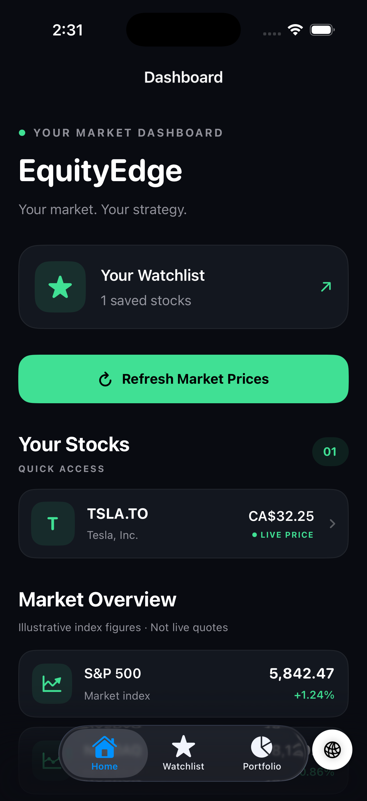
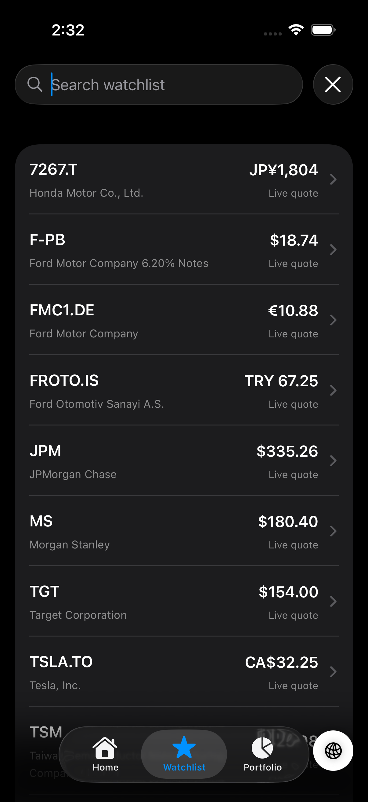
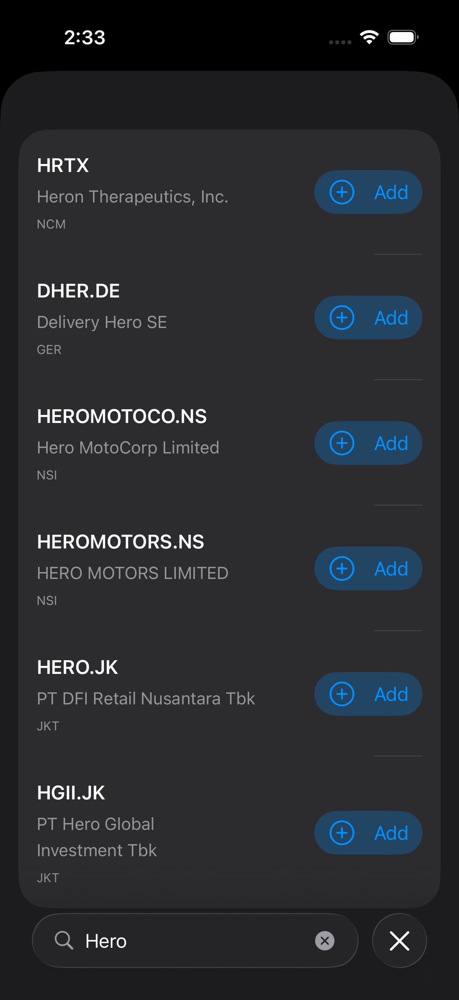
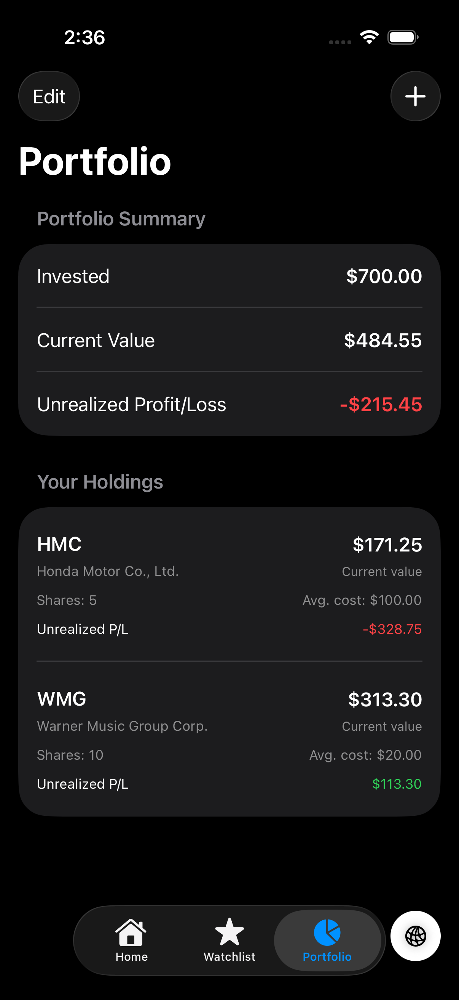
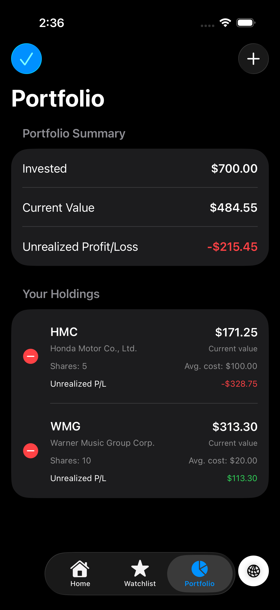
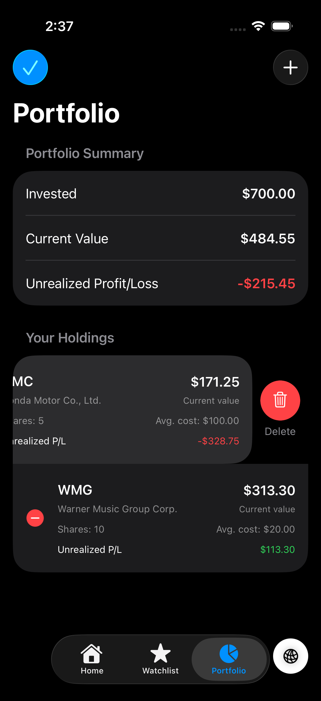
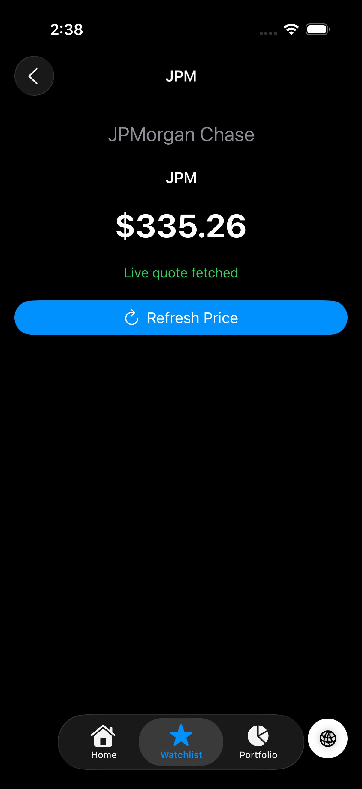
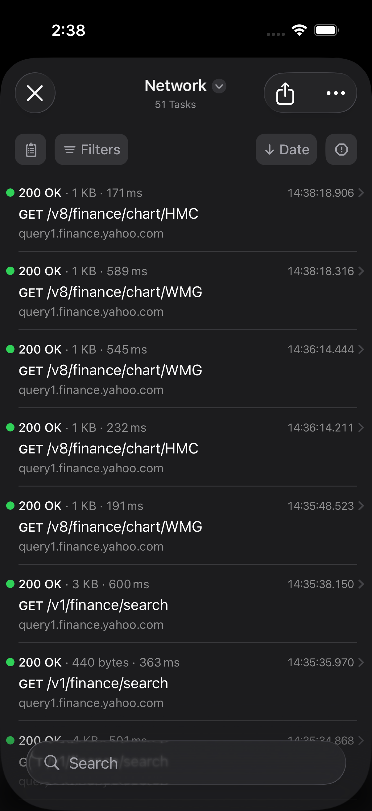

# EquityEdge 📈

**EquityEdge** is a dark-themed iOS stock market application built with Swift and SwiftUI. It brings stock quotes, watchlist management, portfolio tracking, and stock search into one mobile experience.

## 📱 Screenshots

### Dashboard
<p align="center">
  
</p>

### Watchlist
<p align="center">
  
  &nbsp;&nbsp;
  
</p>

### Portfolio
<p align="center">
  
  &nbsp;&nbsp;
  
</p>

<p align="center">
  
</p>

### Stock Details
<p align="center">
  
</p>

### Network Inspector
<p align="center">
  
</p>

## ✨ Features

- **Market Dashboard** — View saved stocks and their fetched prices.
- **Watchlist Management** — Add and manage stocks for quick access.
- **Portfolio Tracking** — Manage portfolio holdings.
- **Stock Details** — Navigate to individual stock detail screens.
- **Stock Search** — Search for stocks using configured market-data services.
- **Quote Refresh** — Request updated stock prices.
- **Local Persistence** — Store watchlist entries and portfolio holdings using SwiftData.
- **Network Inspection** — Inspect network activity during development with Pulse.
- **Dark UI** — Dark backgrounds, emerald accents, and custom stock cards.
- **Dependency Injection** — Share app dependencies through an application container and repository abstraction.

## 🛠 Tech Stack

- **Language:** Swift
- **UI Framework:** SwiftUI
- **Persistence:** SwiftData
- **Concurrency:** Swift Concurrency (`async/await`)
- **Architecture:** Repository Pattern and Dependency Injection
- **Market Data:** Configured Yahoo Finance endpoints
- **Network Debugging:** Pulse and PulseProxy
- **IDE:** Xcode

## 🏗 Architecture

The project separates application setup, domain models, data access, and presentation responsibilities.

- **App** — Application entry point and dependency container.
- **Domain** — Stock models and repository contracts.
- **Data** — Remote services, local persistence models, and repository implementations.
- **Presentation** — Dashboard, Watchlist, Portfolio, Stock Details, Search, and ViewModels.

## 🚀 Getting Started

### Requirements

- macOS
- Xcode with an iOS Simulator
- Swift Package dependencies resolved by Xcode

### Run Locally

1. Clone the repository:

   ```bash
   git clone https://github.com/shaykh-ms/equity-edge.git
   ```

2. Open `EquityEdge.xcodeproj` in Xcode.
3. Allow Xcode to resolve the Swift Package dependencies.
4. Select the `EquityEdge` scheme and an iOS Simulator.
5. Build and run the application.

## 📊 Data Notes

- Quote and search results depend on the availability and response format of the configured market-data endpoints.
- Market index figures currently displayed on the dashboard are illustrative values, not live index quotes.
- This project is for learning and portfolio demonstration purposes. It is not investment advice.

## 👨‍💻 Author

**Mohd Shaya**

Mobile Application Developer | Android · Flutter · iOS Projects
